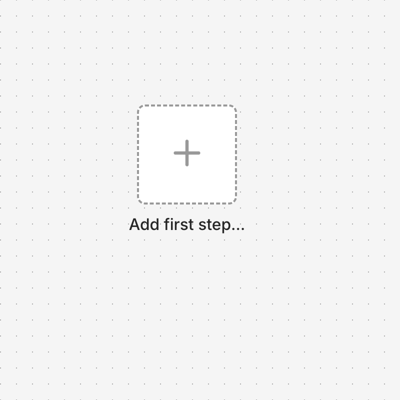
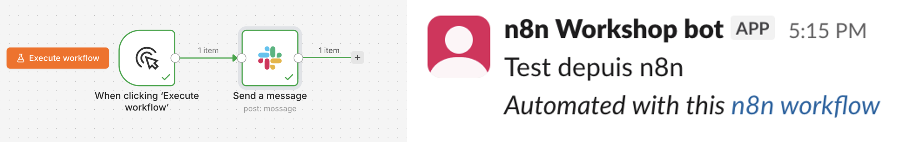
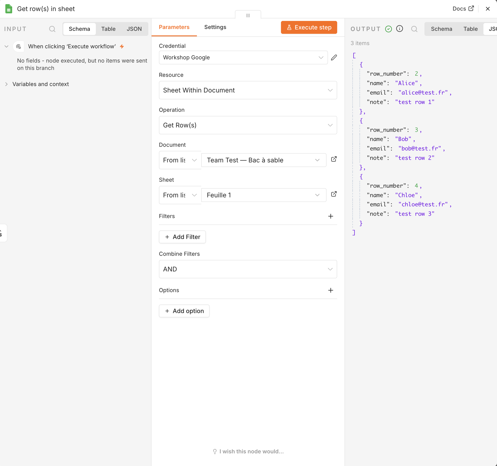

# Ex 1.0 — Setup Sprint ⚙️

**Goal**: your environment works, and you have sent your first message from n8n.

**Time**: 20 minutes. Faster if nothing fights back.

!!! note "Why a 'setup' exercise?"
    Connecting accounts is the first real obstacle in every automation project. So we treat
    it as an exercise, not as a chore. Checkpoints, hints, and then you move on.

---

## CP0 — Join the class Slack workspace

1. Open the invite link:
   [join.slack.com/t/epita-n8n/shared_invite/zt-4djjazkr6-8qzp2OhhZo2r3ExTH7mOCA](https://join.slack.com/t/epita-n8n/shared_invite/zt-4djjazkr6-8qzp2OhhZo2r3ExTH7mOCA)
2. Create your account (any name is fine), join the `Epita-n8n` workspace.
3. Go to the `#test-seance-1` channel — that's where the credential links for CP2–CP4 below
   get posted, and where your bot messages land.

✅ **Done when**: you can see `#test-seance-1` in your sidebar. → CP0.

## CP1 — Logged into your instance

1. Open `http://localhost:5678` — the n8n you started in
   [1.0 — Install n8n (Docker)](ex-1-0-docker-install.md).
2. Log in with the owner account you created there.
3. You should see the empty n8n canvas.

✅ **Done when**: you see "Start from scratch" or an empty canvas. → CP1.

??? tip "Hint 1"
    Owner account not accepted? Check you are using the same email/password you set when
    n8n first opened. There is no "forgot password" on a fresh local instance — if you are
    truly stuck, stop the container and delete the volume to start over:
    `docker compose down -v && docker compose up -d`. You lose nothing, you have not built
    anything yet.

??? tip "Hint 2"
    Still blocked after 2 tries? Raise your hand.

!!! info "3 credentials, given to you in class"
    Slack and Google Sheets are **class-shared accounts** — one value for everyone. The LLM
    key is **yours alone** (one per student, $1 cap each) — see CP4. I will post 3 expiring
    links in `#test-seance-1` right as you reach each part of the exercise. Open each link,
    copy the value straight into your own local n8n, now. Do not screenshot or save them
    anywhere else, and do not reuse them in your own projects — they get shut off once the
    module ends.

## CP2 — Your first workflow: a Slack message

We build the smallest possible workflow: **2 nodes**, started by hand.

1. Click **+ Add first step** → search `Manual Trigger` → add it.
2. Click the **+** on the right of the trigger → search `Slack` → choose **Send a message**.
3. In the Slack node: **Credential** field → **Create new credential**. Choose **Slack API**,
   paste the **Bot token** from the link in `#test-seance-1`, **Save**.
4. **Channel**: `#test-seance-1` · **Message**: anything you want. Everyone can read it.
5. Click **Execute workflow** at the bottom.

✅ **Done when**: your message appears in `#test-seance-1`. → CP2.

??? tip "Hint 1"
    Slack node red? Open it, read the first line of the error (reflex 1 on your
    [survival card](../survival-card.md)). "Channel not found" means the channel name is
    wrong, or the bot was never invited to it — ask.

??? tip "Hint 2"
    "Invalid auth" on save? You likely copied the token with a trailing space, or copied the
    wrong one (it starts with `xoxb-`). Re-open the link, copy again.

## CP3 — Google Sheets answers

1. New workflow (menu → **New workflow**).
2. Add `Manual Trigger`, then a `Google Sheets` node → **Get row(s) in sheet**.
3. **Credential** field → **Create new credential**. Choose **Google Sheets Service Account**,
   paste the service-account JSON key from the link in `#test-seance-1`, **Save**.
4. **Document**: `FoodFleet — Shared Sandbox` · **Sheet**: `Sheet1`.
5. **Execute workflow**. The OUTPUT panel should show a few test rows.

✅ **Done when**: you see data in OUTPUT. → CP3.

??? tip "Hint 1"
    Document missing from the list, or a permission error? The service account needs to be
    shared on the sheet as an Editor — that is already done on the class copy. Re-check you
    pasted the **whole** JSON key, including the outer `{ }`.

## CP4 — Add your LLM credential

The LLM key is different from the other two: it's **yours alone**, not shared with the
class. The `#test-seance-1` link for this one is a list of keys, one per student, each
capped at $1.

1. Open the list, **take any row nobody else has claimed yet**, and say your row number out
   loud so nobody else takes the same one. If two people grab the same row by accident,
   whoever's key fails to save just takes the next unclaimed one — low stakes, it's a $1 cap.
2. Left menu → **Credentials** → **Create credential** → **OpenRouter**.
3. Paste your claimed API key, **Save**.
4. Left menu → **Credentials** again. You should now see three: a Slack credential, a Google
   Sheets credential, and your LLM credential.

✅ **Done when**: all three are there. Do not edit or delete them — you need all three for
the rest of the module. → CP4. Go to Ex 1.1.

!!! note "Default model: `openai/gpt-4o-mini`"
    Use this model for the exercises unless told otherwise — it's cheap and its tool-calling
    works reliably with n8n's AI Agent node. You can try other models later once you
    understand the trade-offs (Séance 2 covers this).

---

!!! success "Finished early?"
    Help a neighbour (rule 1: **do not touch their keyboard**). Or explore the canvas:
    double-click a node and look at its options. You cannot break anything. It is your own
    local instance.
