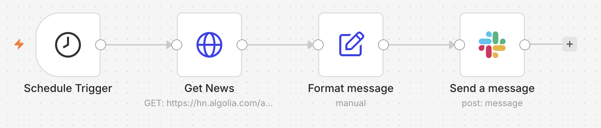
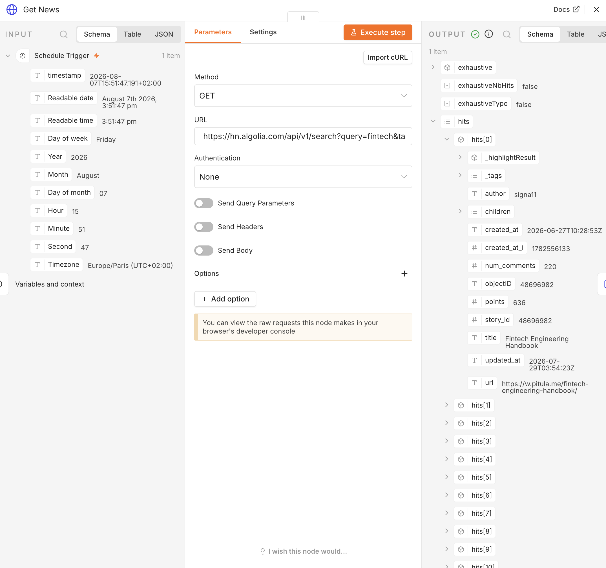
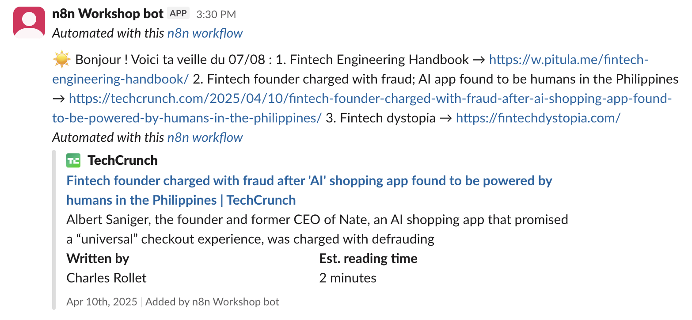

# Ex 1.1 — Good Morning, Founder ☕

**Goal**: every morning at 9:00, a digest of food-industry news arrives in Slack by itself.

**What you learn**: scheduled triggers, calling an API, reading JSON, `{{ }}` expressions.

**Context**: the FoodFleet founder wants one short news digest every morning about her
market. Today you build it for her.

!!! danger "🐛 This workflow has ONE bug — on purpose"
    You import a skeleton we prepared. It contains **exactly one bug, in the "Format
    message" node**. Finding it and fixing it is part of the exercise. Real workflows always
    arrive broken.

## Step 0 — Import the skeleton

1. Download [`good-morning-founder.json`](../skeletons/good-morning-founder.json)
2. In n8n: **⋯** menu (top right) → **Import from file** → pick the file.
3. You should see 4 nodes: `Schedule Trigger` → `Get news (HTTP)` → `Format message` → `Slack`.



## CP1 — The workflow runs

Click **Execute workflow**. Some nodes turn green. Maybe not all of them. That is normal
at this stage.

✅ **Done when**: at least the first 2 nodes are green. → CP1.

## CP2 — Look at what the API returns

1. Open the **Get news (HTTP)** node. It calls the Hacker News search API:
   ```
   https://hn.algolia.com/api/v1/search?query=fintech&tags=story
   ```
2. Look at the **OUTPUT** panel. Find the `hits` list. Each element has a `title`, a `url`,
   and `points`.
3. **Replace `fintech`** with a FoodFleet keyword: `food delivery`, `foodtech`,
   `logistics`, `catering`. Use one English word or two.
4. Re-run the node.



✅ **Done when**: OUTPUT shows articles about the food or delivery market. → CP2.

??? tip "Hint 1"
    OUTPUT empty, `hits: []`? Your keyword is too narrow. Use a broader English word. You
    need results for the next step. They do not have to be perfect.

## CP3 — Find and fix the bug 🐛

1. Open **Format message**. It builds the digest text with expressions:
   ```
   ☀️ Good morning! Here is your FoodFleet digest for {{ $now.format('dd/MM') }}:
   1. {{ $json.hits[0].titel }} → {{ $json.hits[0].url }}
   2. {{ $json.hits[1].title }} → {{ $json.hits[1].url }}
   3. {{ $json.hits[2].title }} → {{ $json.hits[2].url }}
   ```
2. Run the workflow. Read the message it produces. One line is wrong.
3. Fix it. *(Reflex 2 on the survival card: the previous node shows you the real field
   names.)*

✅ **Done when**: all 3 lines show a real title. Nothing empty. → CP3.

??? tip "Hint 1"
    Compare line 1 with lines 2 and 3. Character by character.

??? tip "Hint 2"
    A field that does not exist gives **no red error**. It gives an **empty** string. So
    everything is green and a piece of the sentence is simply missing. That is why this bug
    is nasty.

??? tip "Hint 3 — the answer"
    In the API's JSON the field is called `title`. Line 1 asks for `titel`.

## CP4 — The digest arrives in Slack

1. Open the **Slack** node: credential `Workshop Slack`, channel **`#news`**, message = the
   output of `Format message` (already wired).
2. **Execute workflow** → check Slack.

!!! note "The skeleton arrives with the wrong channel"
    The imported JSON has `#veille` in the Slack node (leftover from another cohort).
    Change it to `#news`. Same thing in Ex 1.3.



✅ **Done when**: your digest is in `#news`. → CP4.

## CP5 — Schedule it for 9:00 tomorrow

1. Open **Schedule Trigger** → set: every day, **09:00**.
2. Top right of the canvas: switch the workflow to **Active**.

✅ **Done when**: the toggle is green / "Active". Tomorrow at 9:00 the digest arrives alone.
→ CP5. 🎉

---

!!! success "Finished early?"
    - Add the `points` of each article: `{{ $json.hits[0].points }} pts`
    - Two keywords at once. Read the API docs: `query=foodtech%20OR%20catering`
    - Build the list with a loop instead of three hardcoded lines. Look at the **Split Out**
      and **Aggregate** nodes. You will need them again in Ex 1.3 and 2.2.
