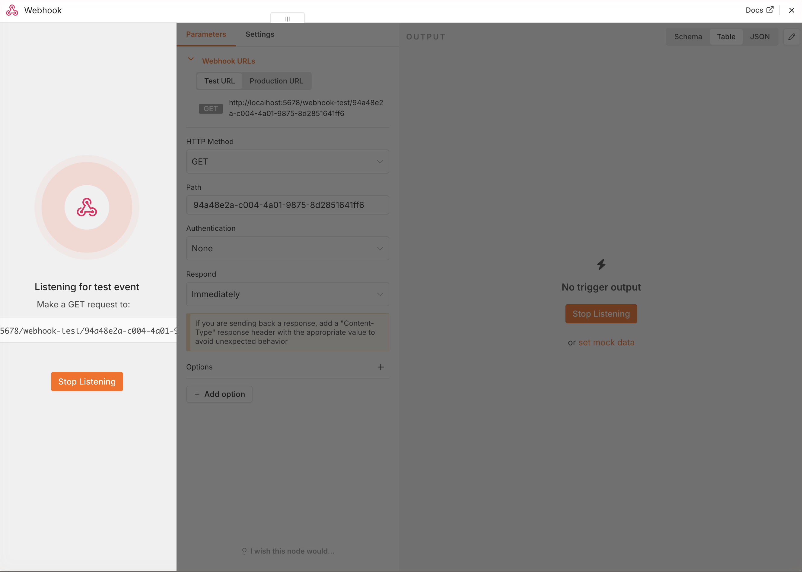
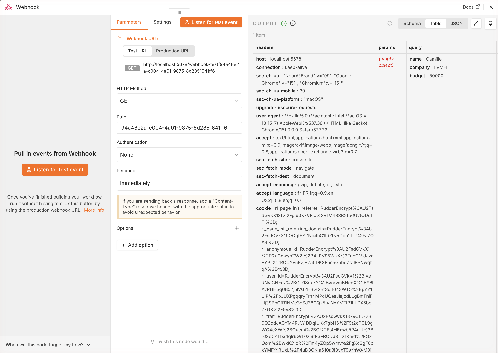
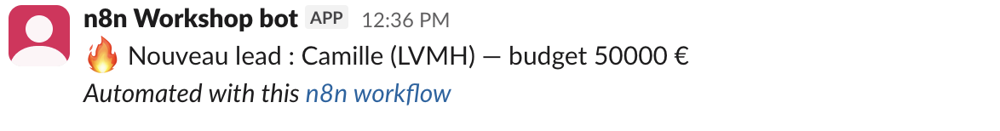

# Ex 1.2 — Lead Landed 🔥

**Goal**: when a prospect fills the FoodFleet web form, a clean alert arrives in Slack
within one second.

**What you learn**: webhooks (the opposite of a clock — here the outside world starts the
workflow), field mapping, and above all **building a workflow from nothing**.

**Context**: FoodFleet has a "request a demo lunch" form on its website. Today nobody sees
the submissions until someone opens the spreadsheet. You fix that.

!!! danger "🏗 Empty canvas — no skeleton this time"
    In 1.1 you repaired an existing workflow. Here you start from **zero**. You find, place
    and connect every node yourself. The screenshots show where you should arrive at each
    checkpoint. Only 3 nodes. You already know everything you need.

## CP1 — The webhook exists and listens

1. **New workflow**, name it `Lead Landed`.
2. **+ Add first step** → search `Webhook` → add it.
3. Open the node. Copy the **Test URL** (copy button).
4. Click **Listen for test event**. The node now waits, like a phone waiting for a call.



✅ **Done when**: the node shows that it is listening. → CP1.

## CP2 — A prospect calls your webhook

In production this URL is wired to the FoodFleet web form. Today, you are the prospect:

1. Open a new tab. Paste your Test URL and **add at the end**:
   ```
   ?name=Camille&company=Dataiku&budget=50000
   ```
   (any values you like — it is your dream customer)
2. Press Enter. The tab shows a small response. In n8n, your webhook received the call.
3. Look at the Webhook node's OUTPUT. **Where are `name`, `company`, `budget`?** Not at the
   top level. They are inside an object called `query`. Remember that path.



✅ **Done when**: you see your three values in OUTPUT, under `query`. → CP2.

??? tip "Hint 1"
    Nothing received? Check two things: the node was on **Listen for test event** BEFORE you
    opened the URL, and you copied the **Test** URL, not the Production one.

## CP3 — The clean alert goes to Slack

1. Add a **Slack → Send a message** node after the webhook. Credential `Workshop Slack`,
   channel `#leads`.
2. Write the message with expressions. Your turn. Expected result:
   ```
   🔥 New FoodFleet lead: Camille (Dataiku) — budget €50,000
   ```
3. Execute the workflow (restart **Listen for test event**, then call the URL again).



✅ **Done when**: the alert arrives in `#leads` with the real values, not empty ones. → CP3.

??? tip "Hint 1"
    Everything empty? Go back to the webhook OUTPUT (reflex 2). Is `name` directly in
    `$json`, or inside an object?

??? tip "Hint 2"
    The path to a field inside a field is formula 2 on the survival card:
    `{{ $json.query.name }}`.

## CP4 — Make it permanent

1. Save, then hit **Publish** (top right — older n8n versions call this toggle **Active**).
2. The webhook's **Production URL** now works all the time. Send it to a neighbour and ask
   them to send you a fake lead.

✅ **Done when**: an alert arrives while the canvas is not even open. Your workflow runs
without you. That is what automation means. → CP4. 🎉

---

!!! success "Finished early?"
    - Add an `email` field with a fallback: `{{ $json.query.email || "not provided" }}`
    - Add a third node: every lead is **also** written into your FoodFleet sandbox Google
      Sheet, one row per lead. That is the start of a real CRM.
    - Switch the webhook to `POST` and send the body with `curl` instead of query
      parameters. Where does the data appear in OUTPUT now?
