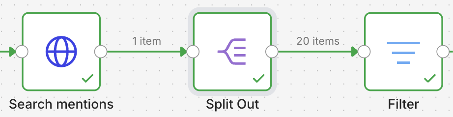
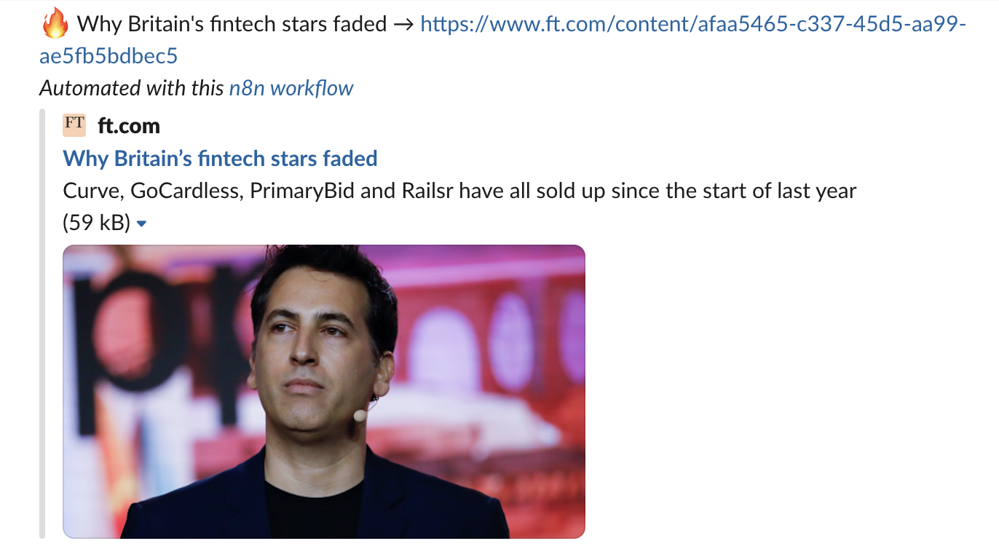

# Ex 1.3 — Mention Radar 📡

**Goal**: when FoodFleet's market gets mentioned online, an alert arrives in Slack.

**What you learn**: polling (checking at regular intervals), filtering items with an IF
node, and the worst kind of bug: the one with **no error at all**.

**Context**: the FoodFleet founder wants to know immediately when a competitor or the
market is mentioned. Not tomorrow morning. Now.

!!! danger "🐛 This skeleton has ONE bug — in the 'Filter' node"
    Special feature: this bug gives **no red node**. The workflow runs green, and sends
    nothing, ever. This is the most dangerous bug in automation: silent success. Good hunt.

## Step 0 — Import the skeleton

[`mention-radar.json`](../skeletons/mention-radar.json) → **Import from file**.

5 nodes: `Schedule Trigger` → `Search mentions (HTTP)` → `Split Out` → `Filter (IF)` →
`Slack`.

## CP1 — Mentions arrive

1. Open **Search mentions (HTTP)**. It asks for the newest stories:
   ```
   https://hn.algolia.com/api/v1/search_by_date?query=fintech&tags=story
   ```
2. Replace `fintech` with a FoodFleet keyword. Keep a common word for this exercise. You
   need enough results to test.
3. Execute. The **Split Out** node turns the `hits` list into separate items. Look at its
   OUTPUT: it is no longer ONE response containing 20 articles, it is **20 items**.



✅ **Done when**: Split Out outputs several items. → CP1.

## CP2 — The bug: nothing passes the filter 🐛

1. Execute the whole workflow. Everything is green, and `#news` stays empty. Nobody is
   notified of anything. **A dead radar that reports "OK".**
2. Open the **Filter (IF)** node. It should let through articles whose `title` contains your
   keyword.
3. Compare what the condition really says with what you want. Fix it.

✅ **Done when**: items come out of the filter's **true** branch. → CP2.

??? tip "Hint 1"
    Look at the **operator** of the condition. "The title IS this word" and "the title
    CONTAINS this word" are very different.

??? tip "Hint 2"
    A title is almost never one single word. `is equal to` will never match a full title
    against `foodtech`. Find the `contains` operator in the list.

??? tip "Hint 3 — think about it"
    How do you catch this class of bug in production, when nobody is watching? One answer:
    an **inverse alert** — "I have sent nothing for 3 days, that is suspicious". Keep this
    idea. Your Séance 3 project needs a failure case, and this is a good one.

## CP3 — The alert goes out

`true` branch → Slack node, message with title and URL. Execute.

The skeleton's Slack node arrives set to `#veille` — change it to `#news`, like in Ex 1.1.



✅ **Done when**: alerts arrive, and *only* for relevant articles. → CP3.

## CP4 — Turn the radar on

Schedule every 30 minutes → **Active**.

✅ **Done when**: it is green. Your radar runs. → CP4. 🎉

---

!!! success "And the real problem with polling?"
    Your radar sends you **the same articles every 30 minutes**. Annoying. That problem —
    "what is actually NEW?" — is exactly the subject of Ex 1.4. Want to look ahead? Open the
    **Remove Duplicates** node and read its option to remember state between runs.
