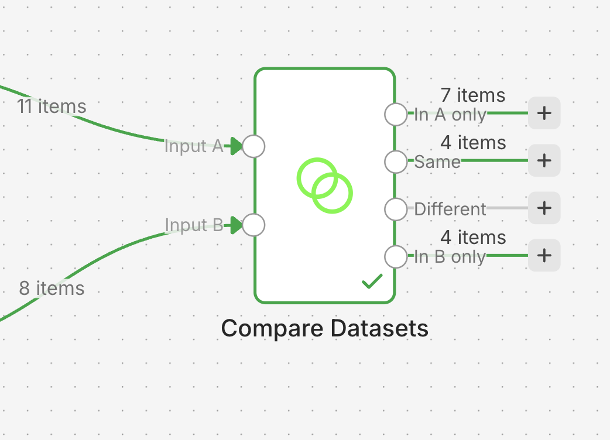

# Ex 1.4 — The Two Spreadsheets 🧹

**Goal**: new FoodFleet sign-ups in spreadsheet A are copied into the CRM (spreadsheet B),
**without ever creating a duplicate**.

**What you learn**: the item model, comparing two datasets, idempotence, and one universal
truth: **real data is dirty**.

**Level**: the hardest exercise of Séance 1. If you finish it, you have understood the most
subtle concept in n8n.

!!! danger "🐛 No hidden bug this time — the DATA is the bug"
    The skeleton is clean. But the spreadsheets are filled like real life: duplicates,
    random capitalisation (`ACME` vs `Acme`), invisible trailing spaces, one half-empty row.
    Your workflow must survive that. No hint tells you where the traps are. Open the data
    and LOOK at it. That is the skill of this exercise.

## Step 0 — Import

[`deux-tableurs.json`](../skeletons/deux-tableurs.json) → 4 nodes, all **disconnected**:
`Manual Trigger`, `Read A (sign-ups)`, `Read B (CRM)`, `Add to B`.

**All the wiring is missing. That is your job**, starting with the Trigger to both reads
(`Trigger` → `Read A` AND `Trigger` → `Read B`: one output going to two nodes).

Your two test tabs are in the shared `FoodFleet — Shared Sandbox` document: `1.4 — Inscriptions`
(the sign-ups) and `1.4 — CRM`. The skeleton's two read nodes already point at them.

!!! tip "Why a Manual Trigger here, when 1.1 and 1.3 did not need one?"
    Here you wire **two different reads** into the same node (Compare Datasets). If you run
    `Read A` then `Read B` separately with each node's **Execute step** button, n8n keeps
    only one result in memory at a time: the second overwrites the first. The Manual Trigger
    plus the **Execute workflow** button re-runs both reads **in the same pass**, so Compare
    Datasets receives both fresh results at once.

## CP1 — You can see both datasets

Wire `Trigger` → `Read A` and `Trigger` → `Read B`. Click **Execute workflow** (not Execute
step on each node — read the box above if you are not sure why).

Look at the OUTPUT of `Read A` and `Read B`. How many sign-ups? How many already in the
CRM? Find with your eyes what will cause trouble. There are at least 3 traps.

✅ **Done when**: you can say out loud which rows of A are *really* new. → CP1.

## CP2 — The machine compares them

1. Find the **Compare Datasets** node. Wire `Read A` and `Read B` into it.
2. Comparison field: `email`. It is the least bad identifier. Names are spelled differently
   every time.
3. **Execute workflow** (from the trigger, not node by node). Look at the node's 4 outputs.
   The one you want: **"In A only"** = the real new sign-ups.



✅ **Done when**: "In A only" contains items. → CP2. **But check the count: is it RIGHT?**
(Probably not. See CP3.)

??? tip "Hint 1"
    The node asks for two inputs, A and B. The order matters. A = the source, B = what
    already exists.

## CP3 — Getting the count right (normalisation)

`MARIE@acme.fr ` and `marie@acme.fr` are the same person for you. Not for a computer. You
must **normalise before comparing**:

1. Insert an **Edit Fields** node after each read (A and B).
2. Rewrite `email` in a clean form: lowercase, no spaces. Two chained functions:
   ```
   {{ $json.email.toLowerCase().trim() }}
   ```
3. **Execute workflow** again. The count in "In A only" should now match what you counted
   with your eyes in CP1.

✅ **Done when**: the machine's count = your human count from CP1. → CP3.

??? tip "Hint 1"
    Count by hand first: how many rows of A have an email that truly does not exist in B,
    once you ignore capitalisation and spaces? That number is your target.

??? tip "Hint 2"
    The row with no email at all? Decide its fate **explicitly** (a Filter before the
    comparison: email is not empty). An automation that does not decide will crash one day,
    at the worst moment.

## CP4 — The sync runs twice

1. Wire "In A only" → `Add to B`. Execute: the new rows enter the CRM.
2. **The real test**: run the whole workflow a SECOND time.

✅ **Done when**: the second run adds **NOTHING** (0 items in "In A only"). That is what "no
duplicates" really means: not "it worked once", but "I can run it a thousand times". → CP4.
👑

---

!!! success "This is the pattern you will reuse most"
    Read two sources, normalise, compare, write only the difference, stay safely re-runnable.
    This is the skeleton of half the automations that exist in companies. You just built it.

    Keep it in mind for Séance 3: **idempotence** is one of the easiest ways to make your
    project look production-quality.
