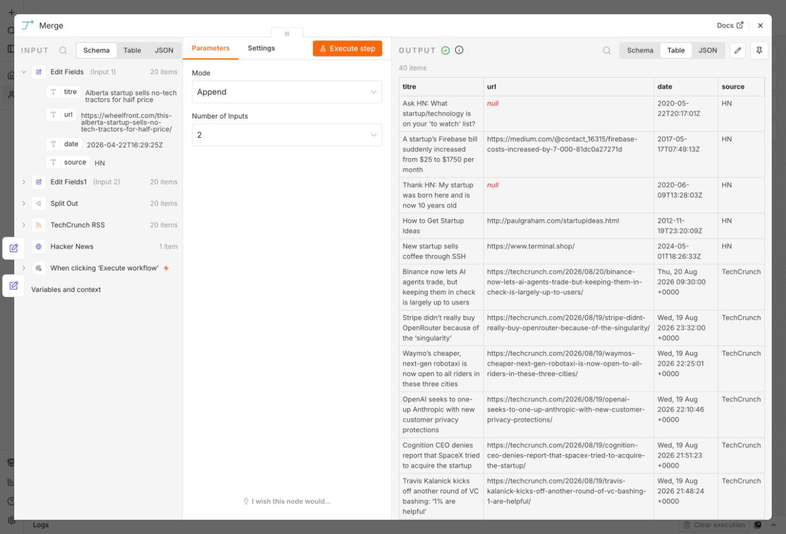

# Ex 2.1 — Two Sources 🌍

**Goal**: your workflow reads **real data** from two different sources and merges it into
one clean stream.

**What you learn**: calling any API, normalising data that does not have the same shape,
merging.

**Canvas**: **empty**. In Séance 1 you proved you can start from nothing. Today you do it
again, with real data.

**Context**: FoodFleet wants market intelligence from more than one place. One source is
never enough, and two sources never speak the same language.

!!! note "Before you start: pick your 2 sources"
    Open the [API Menu](menu-api.md) and follow the method at the bottom of that page.
    **Source 1 must come from the menu.** Source 2 is best effort (⏱ 30 minutes maximum,
    then back to the menu). The two must be different types.

## CP1 — Source 1 answers

1. **New workflow** → `Two Sources`. Manual Trigger for now. We add a clock later.
2. Add your source 1 node (HTTP Request, RSS Read, XML…). Configure it. Execute.
3. Open OUTPUT and **write down** the 3 or 4 useful fields and their exact path (`title`?
   `hits[0].title`? `articles[0].description`?).

✅ **Done when**: fresh data appears in OUTPUT. → CP1.

??? tip "Hint 1"
    HTTP Request: the only required field is the URL. The default GET method already works
    for the whole menu.

## CP2 — Source 2 answers

Same thing, in a **second branch from the same trigger**. One trigger can feed several
parallel paths.

✅ **Done when**: two branches, two full OUTPUTs. → CP2.
*(30 minutes gone and nothing works? Back to the menu. No shame.)*

## CP3 — One single clean stream

Your two sources speak different languages (`title` vs `headline` vs `hits[].title`). You
standardise **before** merging:

1. After each source, add an **Edit Fields** node that produces the SAME 4 fields: `title`,
   `url`, `date`, `source`. Hardcode the source name into `source` (`"HN"`,
   `"RSS TechCrunch"`…).
2. Add a **Merge** node, mode **Append**. Wire both Edit Fields into it.
3. Execute. The Merge OUTPUT should be a list of items that are **indistinguishable**: you
   cannot tell which source an item came from without reading the `source` field.

✅ **Done when**: one single stream, the same fields everywhere. → CP3.

!!! info "Why this matters"
    In real data work, most of the effort is exactly this: making heterogeneous inputs
    uniform before anything clever happens. An AI step placed before normalisation is an AI
    step that gets garbage.

??? tip "Hint 1"
    If a source returns ONE response containing a list (like `hits` in Séance 1), use the
    **Split Out** node from Ex 1.3 first, to turn it into separate items.

??? tip "Hint 2"
    In Edit Fields, each field = the name on the left (`title`), the expression on the right
    (`{{ $json.title }}` — the path you wrote down in CP1).

## CP4 — Re-runnable without duplicates

Run it twice. Do you get the same items twice? Add a **Remove Duplicates** node, comparing
on `url`. Ex 1.4 already showed you why this matters.

✅ **Done when**: two runs in a row do not produce duplicates. → CP4. 🎉

---

!!! success "Finished early?"
    - A third source.
    - A Filter that keeps only items from the last 24 hours (`{{ $json.date }}`, date
      operator).
    - Make the normalisation robust: what happens when `date` is missing from one source?
      Fix it with a fallback before it bites you in Séance 3.
